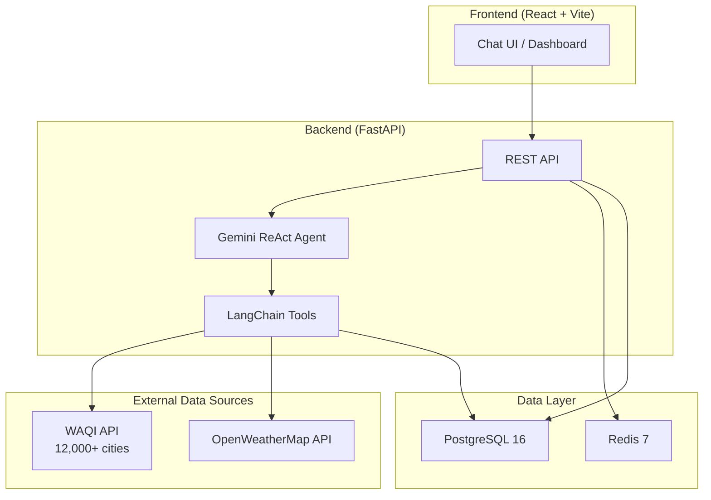
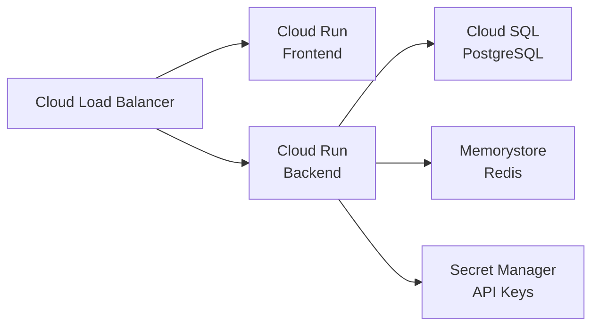

# SmogGuard AI 🌬️🛡️

**GenAI-Powered Air Quality Intelligence Assistant**

[](https://www.python.org/downloads/)
[](https://fastapi.tiangolo.com)
[](https://react.dev)
[](LICENSE)

---

## Overview

SmogGuard AI is a **production-grade GenAI-powered assistant** that helps families and communities navigate severe winter smog and urban air pollution. Built with **Google Gemini AI**, real-time pollution data from **30,000+ monitoring stations worldwide**, and advanced environmental health intelligence.

> [!NOTE]
> SmogGuard AI is not a simple chatbot — it is a **multi-tool reasoning agent** that checks real data, personalizes advice, and quantifies impact using the ReAct (Reasoning + Acting) paradigm.

---

## Key Features

| Feature | Description |
|---|---|
| 🌍 **Real-Time AQI Monitoring** | Live air quality data from WAQI covering 12,000+ cities worldwide |
| 🧠 **Gemini AI Intelligence** | Multi-tool ReAct agent that checks real data, personalizes advice, and quantifies impact |
| 📋 **Daily Routine Planner** | AI-generated low-emission daily schedules based on current pollution levels |
| 🏠 **Indoor Air Quality Advisor** | Budget-conscious tips from DIY solutions to smart home integration |
| 📊 **Impact Tracker** | Quantifies and visualizes your environmental savings over time |
| ⚠️ **Smart Alerts** | Proactive notifications with actionable recommendations when AQI spikes |
| 👨‍👩‍👧‍👦 **Family Safety** | Special considerations for children, elderly, and people with health conditions |

---

## Architecture



---

## Tech Stack

| Layer | Technology |
|---|---|
| **AI** | Google Gemini 2.0 Flash + LangChain (ReAct Agent with Custom Tools) |
| **Backend** | FastAPI + Python 3.12 |
| **Frontend** | React 18 + Vite + Tailwind CSS |
| **Database** | PostgreSQL 16 |
| **Cache** | Redis 7 |
| **Data Sources** | WAQI API, OpenWeatherMap API |
| **Deployment** | Docker + Docker Compose (GCP Cloud Run ready) |

---

## Quick Start

### Prerequisites

- **Docker & Docker Compose** (v2.0+)
- **Google Gemini API key** — free from [AI Studio](https://aistudio.google.com/apikey)

### Setup

```bash
# Clone the repository
git clone <repo-url>
cd smog-guard-ai

# Configure environment
cp .env.example .env
# Edit .env and add your GEMINI_API_KEY

# Launch everything
docker-compose up --build

# Access the app
# Frontend:  http://localhost:3000
# Backend:   http://localhost:8000
# API Docs:  http://localhost:8000/docs
```

> [!TIP]
> The WAQI API token defaults to `demo`, which works for testing but is rate-limited. Get a free token at [aqicn.org](https://aqicn.org/data-platform/token/) for production use.

### Getting API Keys

| Service | URL | Required | Notes |
|---|---|---|---|
| Google Gemini | https://aistudio.google.com/apikey | ✅ Yes | Powers the AI reasoning agent |
| WAQI (AQI data) | https://aqicn.org/data-platform/token/ | Optional | `demo` token works for testing |
| OpenWeatherMap | https://openweathermap.org/api | Optional | Adds weather data for smog risk |

### Seed Demo Data

After services are running, seed the database with sample data:

```bash
# Install seed dependencies
cd data_pipeline
pip install -r requirements.txt

# Run seed script (uses DATABASE_URL from ../.env)
python seed_data.py
```

This creates a demo user (`demo@smogguard.ai` / `demo123`) and fetches live AQI for 10 major cities.

---

## Data Sources

- **WAQI / AQICN** — Real-time AQI from government monitoring stations in 12,000+ cities across 100+ countries. Data sourced from official environmental agencies including the US EPA, China MEP, India CPCB, and more.
- **OpenWeatherMap** — Weather conditions (temperature, humidity, wind) for temperature inversion detection and smog risk modeling.

---

## API Documentation

Interactive **Swagger UI** is available at [http://localhost:8000/docs](http://localhost:8000/docs) when the backend is running.

### Key Endpoints

| Method | Endpoint | Description |
|---|---|---|
| `POST` | `/api/auth/register` | Create a new user account |
| `POST` | `/api/auth/login` | Authenticate and get JWT token |
| `GET` | `/api/aqi/current/{city}` | Get real-time AQI for a city |
| `GET` | `/api/aqi/forecast/{city}` | Get AQI forecast |
| `POST` | `/api/chat` | Send a message to the AI agent |
| `GET` | `/api/conversations` | List user conversations |
| `POST` | `/api/routines/generate` | Generate a daily low-emission routine |
| `GET` | `/api/impact/summary` | Get environmental impact summary |
| `GET` | `/api/alerts/check` | Check current alert status |
| `GET` | `/api/dashboard` | Get full dashboard data |
| `GET` | `/api/health` | Health check |

---

## Project Structure

```
smog-guard-ai/
├── .env.example              # Environment variable template
├── .env                      # Local environment (git-ignored)
├── .gitignore
├── .dockerignore
├── docker-compose.yml        # Full-stack orchestration
├── Dockerfile.backend        # Python backend image
├── Dockerfile.frontend       # Node frontend image
├── README.md
│
├── backend/                  # FastAPI application
│   ├── requirements.txt
│   └── app/
│       ├── __init__.py
│       ├── main.py           # FastAPI app + startup/shutdown
│       ├── config.py         # Pydantic settings
│       ├── models/
│       │   ├── __init__.py
│       │   ├── database.py   # SQLAlchemy async models
│       │   └── schemas.py    # Pydantic request/response schemas
│       ├── services/
│       │   ├── __init__.py
│       │   ├── aqi_service.py      # WAQI + weather API integration
│       │   ├── gemini_agent.py     # LangChain ReAct agent + tools
│       │   └── impact_service.py   # Impact tracking logic
│       └── routers/
│           ├── __init__.py
│           ├── auth.py       # Registration + JWT login
│           ├── aqi.py        # AQI endpoints
│           ├── chat.py       # AI chat endpoints
│           ├── routines.py   # Daily routine generation
│           ├── impact.py     # Impact tracking
│           ├── alerts.py     # Alert management
│           └── dashboard.py  # Dashboard aggregation
│
├── frontend/                 # React + Vite application
│   ├── package.json
│   ├── vite.config.js
│   ├── tailwind.config.js
│   ├── postcss.config.js
│   ├── index.html
│   └── src/
│       ├── main.jsx
│       ├── App.jsx
│       ├── index.css
│       ├── api/
│       │   └── client.js     # Axios instance + interceptors
│       ├── components/
│       │   ├── Layout.jsx
│       │   ├── Sidebar.jsx
│       │   ├── AQIGauge.jsx
│       │   ├── ChatMessage.jsx
│       │   └── ImpactChart.jsx
│       ├── pages/
│       │   ├── Dashboard.jsx
│       │   ├── Chat.jsx
│       │   ├── Routines.jsx
│       │   ├── Impact.jsx
│       │   ├── Alerts.jsx
│       │   ├── Login.jsx
│       │   └── Register.jsx
│       └── context/
│           └── AuthContext.jsx
│
├── data_pipeline/            # Database seeding
│   ├── requirements.txt
│   └── seed_data.py
│
└── deploy/                   # Production deployment
    └── cloudbuild.yaml       # GCP Cloud Build CI/CD
```

---

## Environment Variables

| Variable | Required | Default | Description |
|---|---|---|---|
| `GEMINI_API_KEY` | ✅ Yes | — | Google Gemini API key for AI reasoning |
| `WAQI_API_TOKEN` | Optional | `demo` | WAQI API token for real-time AQI data |
| `OPENWEATHERMAP_API_KEY` | Optional | — | OpenWeatherMap API key for weather data |
| `OPENAQ_API_KEY` | Optional | — | OpenAQ API key (supplementary data) |
| `DATABASE_URL` | Auto | `postgresql+asyncpg://...@db:5432/smogguard` | PostgreSQL connection string |
| `REDIS_URL` | Auto | `redis://redis:6379/0` | Redis connection string |
| `JWT_SECRET_KEY` | ⚠️ Change | Dev fallback | Secret key for JWT token signing |
| `APP_NAME` | Optional | `SmogGuard AI` | Application display name |
| `DEBUG` | Optional | `true` | Enable debug mode |

> [!IMPORTANT]
> Always change `JWT_SECRET_KEY` in production. Generate a secure key with: `python -c "import secrets; print(secrets.token_urlsafe(64))"`

---

## Production Deployment (GCP)

SmogGuard AI is designed for deployment on **Google Cloud Platform** using Cloud Run, Cloud SQL, and Memorystore.

### Architecture



### Deployment Steps

1. **Set up GCP resources:**
   ```bash
   # Create Artifact Registry repo
   gcloud artifacts repositories create smogguard-ai \
     --repository-format=docker --location=us-central1

   # Create Cloud SQL instance
   gcloud sql instances create smogguard-db \
     --database-version=POSTGRES_16 --tier=db-f1-micro \
     --region=us-central1

   # Store secrets
   echo -n "your-key" | gcloud secrets create smogguard-gemini-key --data-file=-
   ```

2. **Deploy with Cloud Build:**
   ```bash
   gcloud builds submit --config=deploy/cloudbuild.yaml
   ```

3. **Configure environment** in Cloud Run service settings or via Secret Manager references.

---

## Development

### Running Without Docker

**Backend:**
```bash
cd backend
python -m venv venv
source venv/bin/activate  # or venv\Scripts\activate on Windows
pip install -r requirements.txt
uvicorn app.main:app --reload --port 8000
```

**Frontend:**
```bash
cd frontend
npm install
npm run dev
```

> [!NOTE]
> When running without Docker, you'll need PostgreSQL and Redis running locally. Update `DATABASE_URL` and `REDIS_URL` in `.env` accordingly.

---

## Contributing

1. Fork the repository
2. Create a feature branch (`git checkout -b feature/amazing-feature`)
3. Commit your changes (`git commit -m 'Add amazing feature'`)
4. Push to the branch (`git push origin feature/amazing-feature`)
5. Open a Pull Request

---

## License

This project is licensed under the **MIT License** — see the [LICENSE](LICENSE) file for details.

---

<p align="center">
  Built with ❤️ for cleaner air and healthier communities
</p>
